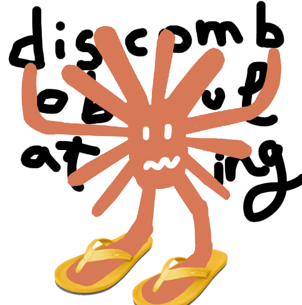
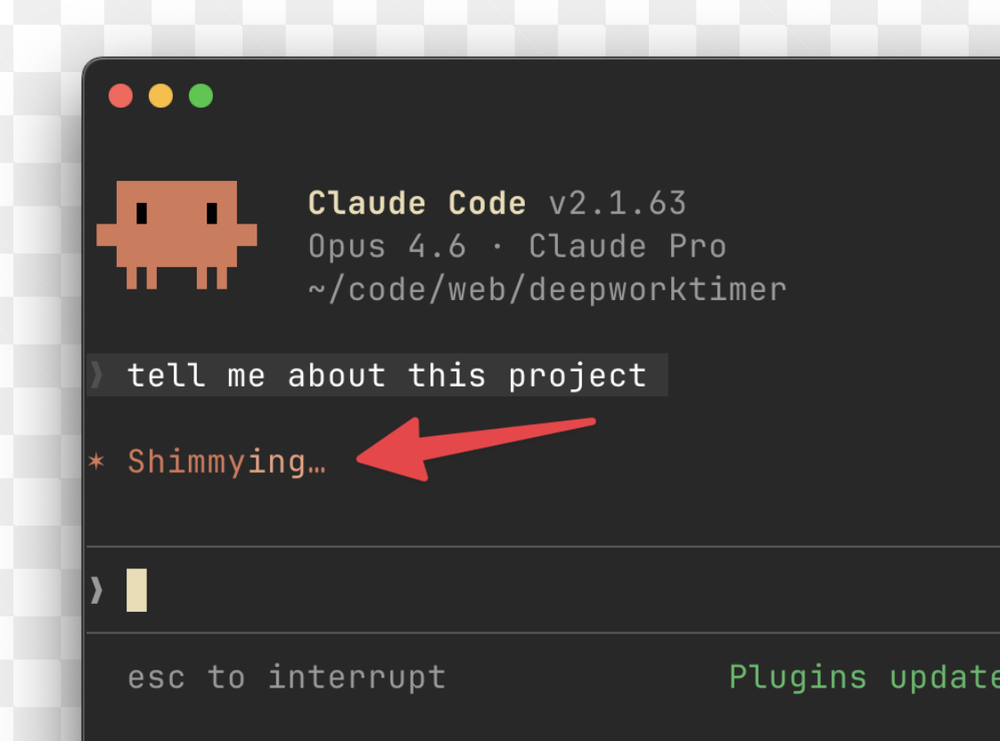
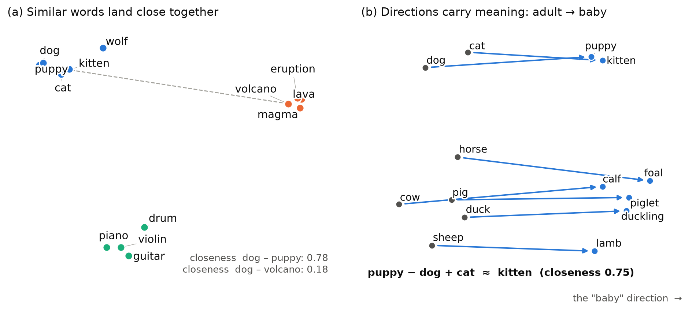
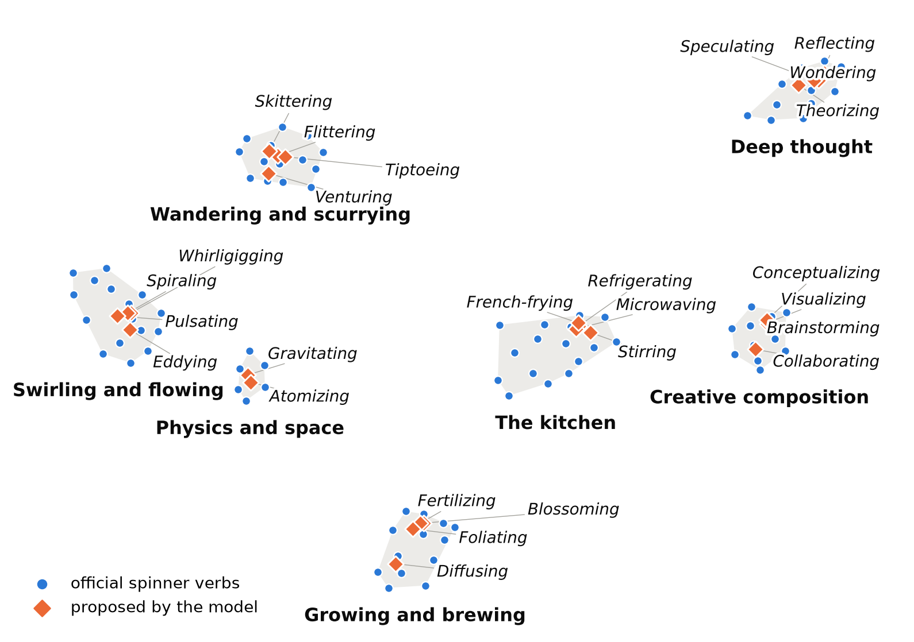

{fig-align="center" width="50%"}

## Spinner verbs
Whenever you ask Claude a question, a little spinner appears while it thinks and next to it some word like "Discombobulating", "Crystallizing", or "Moonwalking". These are "spinner verbs", in total there are 187 different ones. Basically their role is to have something entertaining while you wait instead of it just saying "Loading..."

Some other examples are Simmering, Flummoxing, Watchamacalliting, Dilly-dallying, Bebopping, Meandering, Spelunking, Orbiting, Transmuting, Quantumizing etc etc.

The thing is that they all share a similar style even though they can be about very different things.  "Simmering" and "Quantumizing" have nothing in common in meaning but they feel right. "Loading" or "Running" would feel wrong even though they describe what Claude is actually doing. 

In this post we will explore a method for proposing new verbs like these using word embeddings and some basic data science.

{fig-align="center" width="70%"}

## Word embeddings
If we want to analyze these verbs we need a way to represent them mathematically. For this we use word embeddings.
A word embedding represents a word as a list of numbers, which we can interpret as vectors. A neural network reads enormous amounts of text and assigns those coordinates so that words used in similar ways land near each other. For example, it notices that "dog", "puppy" and "cat" appear in similar sentences and puts them close together, while "dog" and "volcano" end up far apart. Distance works now as a measure of similarity (see Annex A), and once words are points in space we can work with their meaning using simple geometry and linear algebra. For example we can find neighbours, group into themes with clusters of points, or find regions where certain words live.

Here we use all-mpnet-base-v2, an open sentence embedding model that turns each word into a 768-dimension vector that we normalize to length one (see Annex A).

Also, here we are working with 768-dimensional geometry, so some of our intuition about distances doesn't necessarily translate (see post [Everybody lives in Ecuador](../everybody_lives_in_ecuador/everybody_lives_in_ecuador.qmd) for a discussion of this). For some things it's the same, but for example the angle between two random vectors is usually almost $90°$, so if two vectors have an angle of $60°$ between them it means that they are actually much more similar than we would think, living in a 3D world. 


{#fig-toy width=100%}


## Candidate verbs 
For the candidates we take 9,000 gerunds from WordNet (see Annex F), and for the spinner verbs we use the list of 187 verbs that Claude uses. We embed all of them and run a vibe-check to eliminate negative verbs. Since the spinner verbs appear in a the screen while we wait, it would be weird to have a verb that is negative or violent.

How do we do this? We can take advantage of how embeddings work. We measure the distance between each candidate and several "positive" words (delightful, playful, cozy, etc) and several "negative" words (violent, disease, manipulative, etc). If a candidate is closer to the negative words than the positive words we discard it (see Annex B). This eliminates about 1,500 candidates, some of which would have otherwise been good spinner verbs. For example, "Conspiring", "Force-feeding", and ironically "Hallucinating".

We could now be tempted calculate the average embedding of the spinner verbs, and find the candidates closest to that average verb. This does not work. There are many themes in the spinner verbs, for example cooking ("Simmering", "Sautéeing", "Marinating", "Braising") or physics ("Ionizing", "Crystalizing", "Quantumizing"). If we just took the average, it would fall somewhere in the middle but not close to any single one. But first, we need a way to evaluate if a candidate would make a good spinner verb or not.


## Evaluating candidates
To evaluate how good a candidate is we run a logistic regression model trained on the spinner verbs' embeddings and 8 features (length, rarity, rare letters, etc) (see Annex C). We can then give a score to each candidate and rank them (see Annex C). Using this method words like "Brainstorming", "Formulating", and "Stirring" get top scores while words like "Hazing", "Court-martialing", and "Chain-smoking" fall to the bottom. So far so good.


| # | Best candidates | Failed the vibe check | Worst candidates |
|--:|:--|:--|:--|
| 1 | Whirligigging | Hallucinating | De-ionating |
| 2 | Wriggling | Centrifugating | De-accessing |
| 3 | Brainstorming | Force-feeding | De-iodinating |
| 4 | Oscillating | Centrifuging | Ill-treating |
| 5 | Wiggling | Sleepwalking | Re-arming |
| 6 | Teeter-tottering | Conspiring | Re-equipping |
| 7 | Flittering | Procrastinating | Chain-smoking |
| 8 | Vacillating | Reprocessing | De-emphasizing |
| 9 | Whirling | Pressure-cooking | Re-addressing |
| 10 | Freewheeling | Disembowelling | Re-afforesting |

: Plain ranking by model score. Left: best candidates that pass every filter. Middle: the highest-scoring words removed by the vibe check. Right: the words the model finds least spinner-like (ranked before the vibe check). Many of the worst candidates don't pass the vibe check. {#tbl-rankings}

It's interesting how most of the worst candidates are hyphenated while also many good candidates are hyphenated (flip-flopping, teeter-tottering). Out of the official spinner verbs, the hyphenated ones have some kind of rhyme or repetition (Dilly-dallying, Razzle-dazzling) so the model learned (see Annex C) that a hyphen alone is bad (which is a very clear indicator) but a hyphen with repetition is good.


My personal favorite is *Leapfrogging* since it has a funny vibe and also references the leapfrog symplectic integrator.

Some other ones I liked are *Oscillating*, *Somersaulting*, *Whizzing*, *Weaving*, *Twiddling*, and  *Scintillating*.

In this search bar you can type any word and see how good it is (see Annex C). It also tells you if it is an official spinner verb, closest spinner verb, and whether or not it passed the vibe check.
```{ojs}
//| echo: false
viewof query = Inputs.text({placeholder: "Try Knitting, Moonwalking, Hallucinating…", label: "Search a word"})
```

```{ojs}
//| echo: false
query.trim().length < 2
  ? html`<p style="color:#52514e;">Type at least two letters. The list has ${words.length.toLocaleString("en")} words.</p>`
  : matches.length
    ? html`${matches.map(card)}`
    : html`<p style="color:#52514e;">"${query}" is not among the ${words.length.toLocaleString("en")} words: it may be an invented word, a non-verb, or removed by the safety blocklist.</p>`
```

```{ojs}
//| echo: false
//| output: false
words = (await FileAttachment("word_scores.csv").csv()).map(d => ({
  ...d, pct: +d.pct, closeness: +d.closeness,
  key: d.word.toLowerCase(), lemmaKey: d.lemma.toLowerCase()
}))

matches = {
  const q = query.trim().toLowerCase();
  if (q.length < 2) return [];
  const exact = words.filter(d => d.key === q || d.lemmaKey === q);
  const starts = words.filter(d => !exact.includes(d) && d.key.startsWith(q));
  const inside = words.filter(d => !exact.includes(d) && !starts.includes(d) && d.key.includes(q));
  return [...exact, ...starts, ...inside].slice(0, 6);
}

statusText = ({
  "official": "Official spinner verb (scored while hidden from the model)",
  "candidate": "Candidate",
  "failed the vibe check": "Candidate, but failed the vibe check",
  "British spelling": "Filtered: British spelling of an American form",
  "removed by Anthropic": "Was an official verb, later removed by Anthropic",
  "same verb as an official one": "Filtered: another form of an official verb",
  "removed by hand": "Filtered by hand (veto list)"
})

topText = p => {
  const t = (1 - p) * 100;
  return t < 1 ? `top ${Math.max(t, 0.1).toFixed(1)}%` : t <= 50 ? `top ${t.toFixed(0)}%` : `bottom ${(100 - t).toFixed(0)}%`;
}

card = d => html`<div style="border:1px solid #e4e3df;border-radius:8px;padding:10px 14px;margin:8px 0;">
  <div style="display:flex;justify-content:space-between;align-items:baseline;gap:12px;">
    <strong style="font-size:1.15em;">${d.word}</strong>
    <span><strong>${topText(d.pct)}</strong> <span style="color:#52514e;">(score ${(100 * d.pct).toFixed(1)} / 100)</span></span>
  </div>
  <div style="background:#eeede9;border-radius:4px;height:8px;margin:6px 0 8px;">
    <div style="width:${(100 * d.pct).toFixed(1)}%;background:${d.status === "official" ? "#2a78d6" : "#eb6834"};height:8px;border-radius:4px;"></div>
  </div>
  <div style="color:#52514e;font-size:0.92em;line-height:1.5;">
    ${statusText[d.status]}${d.note ? html`&nbsp;· <strong>${d.note}</strong>` : ""}<br>
    Closest theme: ${d.theme} · Closest official verb: ${d.nearest} (closeness ${d.closeness.toFixed(2)})
  </div>
</div>`
```


## Clustering and themes
Another way to find good candidates is to identify the themes we already talked about and find candidates that fit into those themes. Using Ward clustering we divide the 187 spinner verbs into 15 groups (see Annex D). Then, from each group we find the candidates with the highest score that lie inside that region (see Annex D). This gives us a list of good candidates that also fit inside the existing themes. 
Here are some examples.


| Theme | Official verbs | Examples of official verbs | Proposed by the model |
|:--|--:|:--|:--|
| The kitchen | 17 | Cooking, Seasoning, Sautéing, Caramelizing | Stirring, Refrigerating, Microwaving, French-frying |
| Swirling and flowing | 16 | Whirring, Swirling, Whirlpooling, Undulating | Whirligigging, Eddying, Spiraling, Pulsating |
| Growing and brewing | 14 | Germinating, Sprouting, Incubating, Percolating | Blossoming, Diffusing, Fertilizing, Foliating |
| Wandering and scurrying | 14 | Scurrying, Skedaddling, Meandering, Moseying | Flittering, Venturing, Tiptoeing, Skittering |
| Deep thought | 12 | Pondering, Thinking, Deliberating, Mulling | Wondering, Theorizing, Reflecting, Speculating |
| Creative composition | 11 | Sketching, Envisioning, Composing, Improvising | Brainstorming, Visualizing, Collaborating, Conceptualizing |
| Physics and space | 6 | Ionizing, Nucleating, Orbiting, Quantumizing | Gravitating, Atomizing |

: Some examples of themes and their proposed additions. {#tbl-themes}


{#fig-map width=95%}


My favorite is *Eddyng* since it fits the swirly theme, is fun to say, and is related to physics (eddy currents, eddy viscosity, etc). 

## New themes
We can also try to find new themes to add. For example, we can look at words that score highly but are not close to any existing cluster (see Annex E). These words score highly because of their style and not because they have similar meaning to the spinner verbs.

Again we see some propositions.

| New theme | Words | Tightness |
|:--|:--|--:|
| Sparkles and glitter | Twinkling, Sparkling, Shimmering, Glittering | 0.87 |
| Needlework | Stitching, Embroidering, Knitting, Quilting, Crocheting, Sewing, Yarning | 0.87 |
| Spins and turns | Eclipsing, Turning, Circularizing, Revolving, Circling, Rotating | 0.83 |
| Tricks and skids | Flip-flopping, Slaloming, Side-slipping, Sidestepping, Skidding | 0.78 |
| Journeys | Spacewalking, Pirouetting, Strolling, Teleporting, Crisscrossing, Navigating, Circumnavigating, Walking | 0.78 |

: New themes: See Annex E for how we define tightness. {#tbl-newthemes}

Out of these my favorites are *Slaloming*, *Circumnavigating*, and *Shimmering*.

## Annex
# A. From a word to a vector


**Model.** `sentence-transformers/all-mpnet-base-v2`: a transformer encoder (MPNet) fine-tuned so that sentences with similar meaning get nearby vectors. Its output for a piece of text is the average of its token vectors (mean pooling), a vector in $\mathbb{R}^{768}$.

**Carrier sentences.** The encoder is trained on sentences, and a bare word like "Baking" is ambiguous (a verb? an adjective?). So each word $w$ is fed to the encoder in 5 short templates:

> "{w}", "{w}...", "Claude is {w}.", "The assistant is busy {w}.", "Please wait while I finish {w}."

The 5 vectors are averaged. The shared sentence part is roughly the same for every word, so it mostly cancels out in comparisons, and what is left is the word as an activity in progress.

**Normalisation.** The average is scaled to length one,
$$
u_w = \frac{\bar e_w}{\lVert \bar e_w \rVert}, \qquad \bar e_w = \frac{1}{5}\sum_{t=1}^{5} e_{t}(w).
$$

**Distance and closeness.** For unit vectors, the (Euclidean) distance and the dot product carry the same information:
$$
\lVert u_a - u_b \rVert^2 = 2 - 2\,u_a \cdot u_b .
$$
Small distance means large dot product. Throughout the post (and in the search box) "closeness" is $u_a\cdot u_b$ (between $-1$ and $1$; in practice 0.2 to 0.9 here). Ranking words by distance or by closeness gives the same order.


# B. Vibe check 

**Anchors.** 8 pleasant anchors $P$: *delightful, playful, cozy, whimsical, cheerful, gentle, curious, charming*. 14 unpleasant anchors $U$: *violent, sexual, disease, illness, cruel, creepy, manipulative, bodily fluids, medical procedure, harassment, death, insulting, disgusting, deceitful*. They are embedded like any other word.

**Vibe value.**
$$
\text{vibe}(w) = \frac{1}{|P|}\sum_{p\in P} u_w\cdot u_p \;-\; \frac{1}{|U|}\sum_{n\in U} u_w\cdot u_n .
$$

**Threshold.** The bar is not zero. It is set by Anthropic's own list: a candidate must be at least as pleasant as the 1st percentile of the 187 official verbs ($\text{vibe} \ge -0.030$). So the bar is calibrated on what Anthropic was happy to ship (their least pleasant verbs are *Garnishing*, *Osmosing*, *Booping*). Because the bar is slightly below zero, it is a little more lenient than the simple rule in the main text ("closer to the negative words than to the positive ones").


# C. Logistic regression


**Labels.** The 187 official verbs are labelled 1. Every other candidate is labelled 0.

A label 0 doesn't necessarily mean it's a bad spinner verb, just that we don't know if it is. This setting is called positive–unlabelled learning. The scores are then not true probabilities, but the ranking is still meaningful, and the ranking is all we use.

**Input.** For each word, $x_w = [\,u_w \,;\, f_w\,] \in \mathbb{R}^{768+8}$: the embedding plus 8 standardised features:

| Feature | Meaning |
|:--|:--|
| zipf | word frequency on a log scale (wordfreq) |
| length | number of characters |
| syllables | number of syllables |
| hyphen | 1 if hyphenated (*Flip-flopping*) |
| redup | 1 if reduplicative (*Teeter-tottering*, *Pitter-pattering*) |
| silly_letters | share of the letters z, k, q, x, j, w in the stem |
| double_letters | number of doubled letters |
| latinate | 1 if it ends in -ating, -izing, -ifying, -escing, -ulating |

: The 8 features. {#tbl-features}

**Model.**
$$
p(w) = \sigma(\beta^\top x_w + b) = \frac{1}{1+e^{-(\beta^\top x_w + b)}}
$$
Here $\beta$ and $b$ minimise the weighted log-loss plus an L2 penalty:
$$
\min_{\beta,b}\; \frac{1}{2C}\lVert\beta\rVert^2 \;-\; \sum_w \omega_{y_w}\big[y_w\log p(w) + (1-y_w)\log(1-p(w))\big].
$$
We use $C = 0.3$ (chosen by cross-validation from 0.3, 1, 3, 10). The weights are "balanced" ($\omega_1 \approx 47\,\omega_0$), so the 187 positives count as much as the thousands of negatives. The score shown in the post is the percentile of $\beta^\top x_w + b$. Official verbs are scored while hidden from the model (see below).

**Does it work?** We hide part of the official verbs and check where the model ranks them among the hidden candidates.

| Method | ROC AUC | Share of hidden spinner verbs in top 5% |
|:--|--:|--:|
| Random | 0.51 | 5% |
| Pick rare words | 0.44 | 2% |
| Closeness to the average spinner verb | 0.62 | 6% |
| Closeness to the 5 nearest spinner verbs | 0.75 | 26% |
| Logistic regression, embedding only | 0.83 | 34% |
| Logistic regression, embedding + features | 0.83 | 40% |

: 5-fold cross-validation: the official verbs are split into 5 parts, and each part is hidden in turn together with a fifth of the other words. Top 5% = the top 5% of the hidden words in that round. AUC = probability that a random hidden spinner verb is ranked above a random hidden candidate (0.5 = chance). {#tbl-cv}

The 40% (the share of hidden official verbs that land in the top 5%) doesn't seem too good, but it is 8x better than chance, and the median hidden verb falls in the 91st percentile of the hidden words. Also, 187 positive labels are not that many, and many of the words that beat them can also genuinely be good spinner verbs, so the model is not wrong to rank them high. 

# D. Ward clustering and maximal relevance

**Ward clustering.** Start with each of the 187 verbs as its own cluster. At every step, merge the two clusters whose merge increases the total within-cluster spread the least:
$$
\Delta(A,B) = \frac{|A|\,|B|}{|A|+|B|}\,\lVert \mu_A - \mu_B \rVert^2,
$$
where $\mu_A$ is the mean vector of cluster $A$. This favours compact, similar-sized groups. Stopping at $k$ clusters gives the themes. We chose $k=15$ by the silhouette score over $k = 6,\dots,20$ (the silhouette compares how close each verb is to its own group with how close it is to the next group. higher is better). 

**Centroid.** A theme's centre is the mean of its members' vectors, rescaled to length one: $c_k = \mu_k / \lVert\mu_k\rVert$.

**Does a candidate fit a theme?** Each candidate goes to its closest centre, but closest is not the same as close. A word far from everything would still be forced into the least-far theme. So a candidate $w$ is allowed into theme $k$ only if
$$
u_w\cdot c_k \;\ge\; \text{bar}_k = \min\big(q_{0.05}\{u_v\cdot c_k : v \in k\},\; 0.72\big)
$$
In words, it must be as close to the centre as all but the 5% least central official verbs of that theme. The cap 0.72 (the median closeness of all official verbs to their own centre) stops a tiny theme of near-synonyms from rejecting good fits just because the others are much closer. The candidate must also be in the model's top 15% best scoring verbs.


**The catch-all theme.** For example the theme containing (Accomplishing, Doing, but also Cascading, Enchanting, Razzle-dazzling) collects the official verbs that fit no sharper theme. So its centre is almost the average of *all* candidates <!-- CLAUDE EDIT -->(closeness 0.93 to that average, against 0.63 for the most specific theme), and it is the closest theme for 31% of all candidates. For this theme, "close to the centre" just means "a generic verb", which is why its proposals (Genuflecting, Exhilarating, Dovetailing) are weak. This shows that the method is not perfect.

**Maximal Marginal Relevance (MMR).** Among the 80 best-scoring candidates that fit, we pick up to 8 one at a time. Each pick is
$$
w^* = \arg\max_{w \notin S}\; \lambda\, s(w) - (1-\lambda)\max_{v\in S} u_w\cdot u_v, \qquad \lambda = 0.7,
$$
where $s(w)\in[0,1]$ is the score stretched so that the worst clean candidate is 0 and the best is 1, and $S$ the words already picked. The second term punishes a word for being too close to one already picked, so we don't get five synonyms of *Simmering*.


# E. Finding new themes

1. Keep the top 6% of candidates by score.
2. Keep only the words that fail the fit test of Annex D for **all 15** themes: good words that belong nowhere (113 words).
3. Group them with Ward clustering.
4. Keep a group only if it has at least 4 words and is tight enough.

**Tightness** is the average closeness of a group's words to the group's centre (its normalised mean vector, as in Annex D). Anthropic's own 15 themes range from 0.64 to 0.77 (plus 0.89 for a tiny theme of four *trans-* synonyms). A new theme needs at least 0.76, i.e. it must be tighter than 13 of the 15 real themes. With a stricter bar (0.80) only Sparkles, Needlework and Spins & turns survive, with a looser one, groups without a clear theme appear.

# F. Building the candidate list

- **Sources.** Every WordNet verb turned into its -ing form (with lemminflect), plus every -ing word in the wordfreq English list that comes from a real verb. Hyphenated verbs are kept (*flip-flop*, *dilly-dally*), so that a hyphen alone does not give away "spinner verb".

- **Size.** 9,016 words in total (8,992 real English words + 24 official coinages like *Clauding*). After removing official verbs, British spellings, the vibe check and the veto, **6,741** candidates can be proposed.
