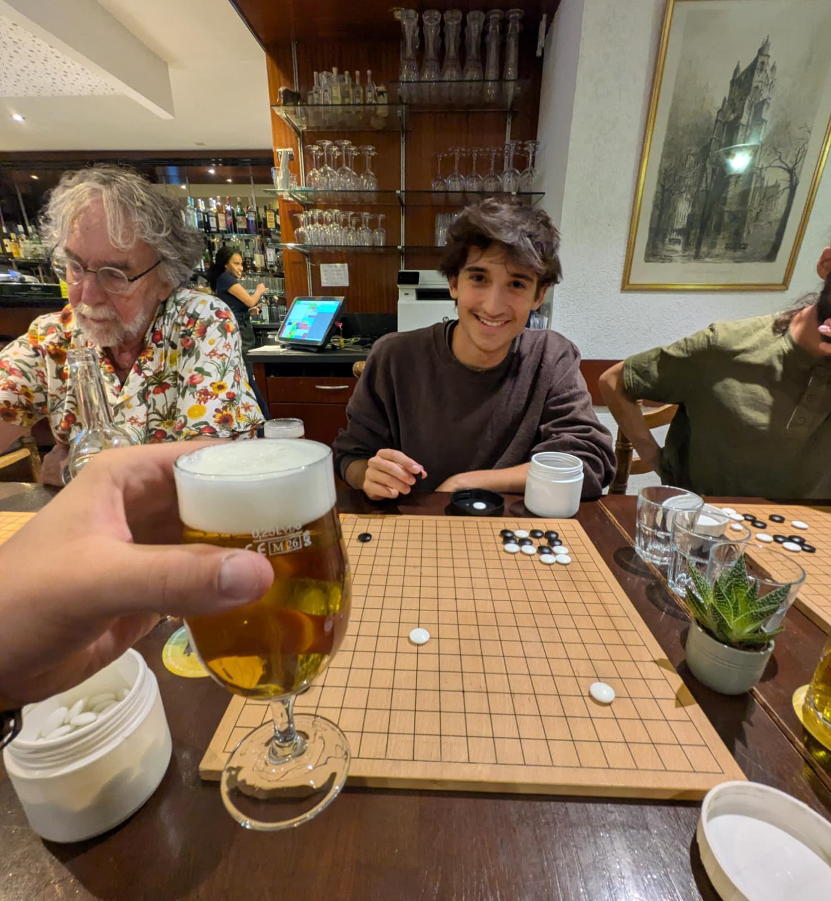
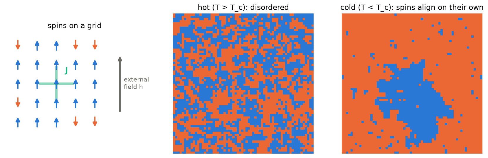
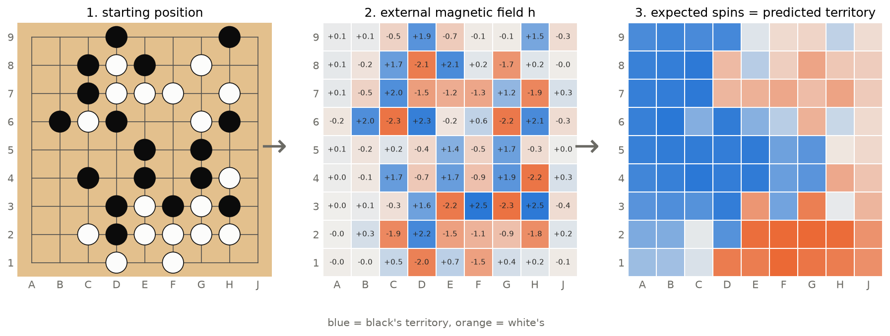
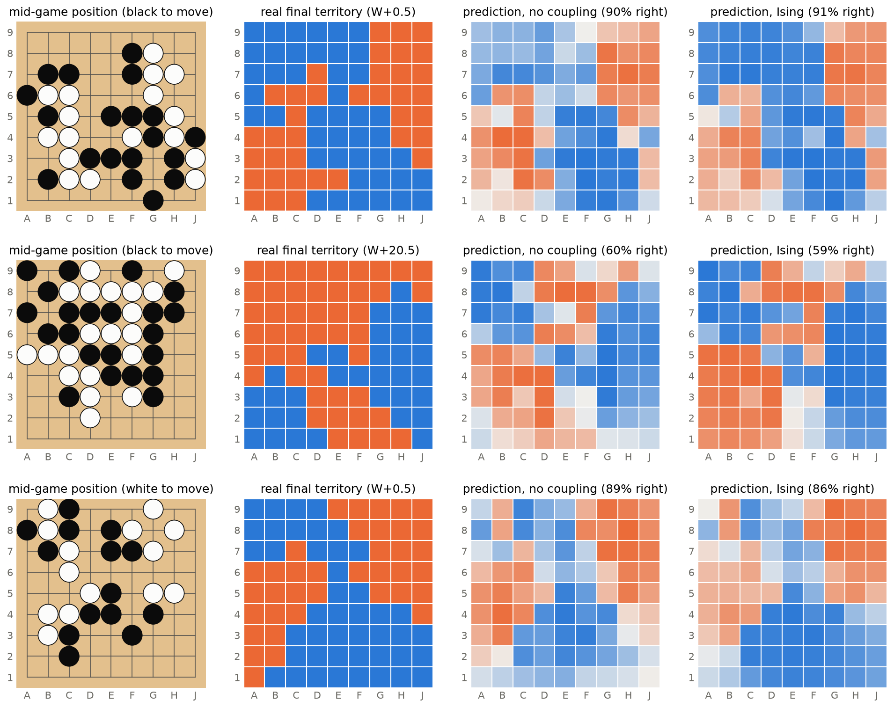
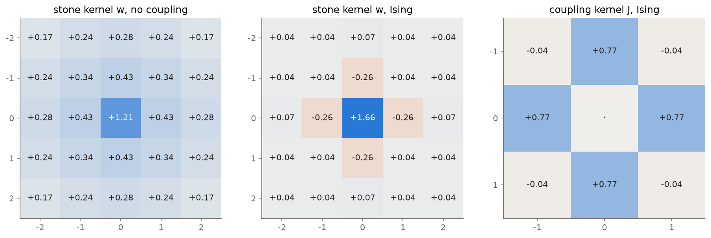
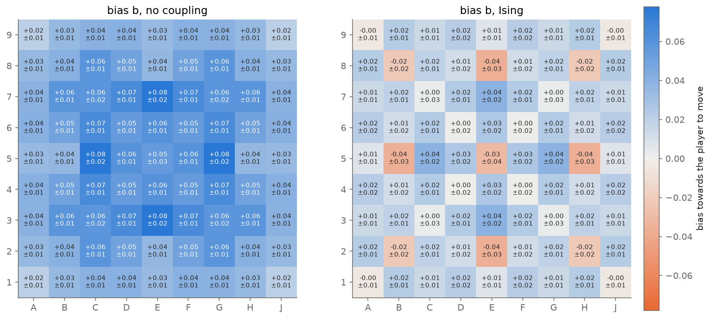
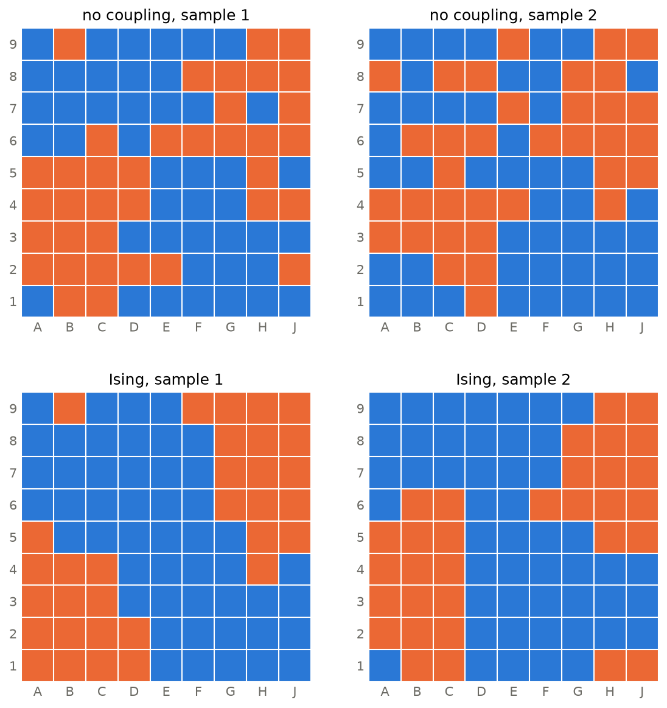
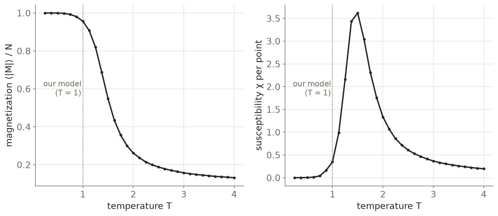
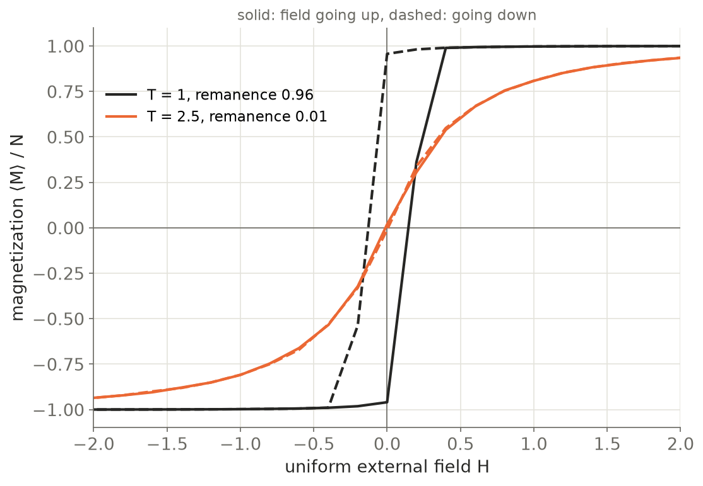
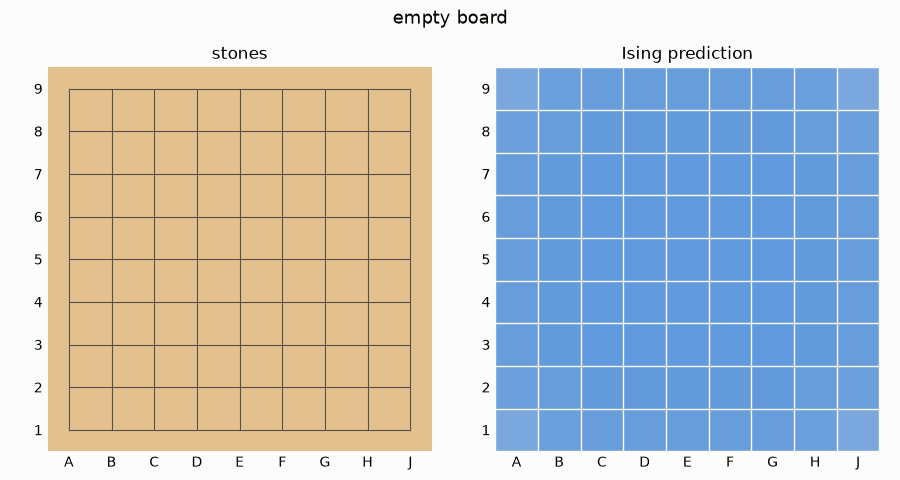

## What is Go

Lately I've been playing some *Go* with my friend Juan (*not* myself). Go is a Chinese board game where you basically
have to place stones on a grid to capture territory. A group of stones is captured when it loses all its *liberties* (the empty points
adjacent to it) i.e. when it is completely surrounded by enemy stones. As the nerds we are, we quickly noticed some similarities
between the game of Go and the Ising model for ferromagnetism.

{fig-align="center" width="70%"}

## What is the Ising model

The Ising model is a model for ferromagnetism developed in the 1920s. Essentially, it treats a material as a grid of tiny
magnets (spins) that can point either up or down. The probability of finding the
material in a given configuration (some combination of up and down spins)
depends on its energy, which depends on two things (more in [Annex A](#annex-a)): 1. the external magnetic field,
which pushes every spin in its direction, and 2. the interaction between neighbouring
spins. When neighbours prefer to point the same way, the spins can align on their
own, even without an external field, and the material is ferromagnetic.

The similarities lie in the fact that *liberties* in Go are like spin coupling in the Ising model (your orthogonal neighbours affect whether you stay alive or not), territory can be white/black like spins are up/down, and that you end up with blocks of territory (lonely pieces die).

Also, I'm sadly (and obviously) not the first person to ever make this connection (see Stern et al., 2004, or Alvarado et al., 2017).

## The model
I now set out to describe predicting the outcome of Go games with this model, and hopefully try to see if it makes
sense to define some notion of ferromagnetism for the game. 

Grosso modo this is the solution we will use: start from a given position, and treat the existing stones as an external magnetic field.
Then, with that external field, compute the probability distribution of an Ising model and take the prediction of the final outcome
as the expected spins.

Essentially what we want is to find the parameters that assign low energies to the real final territory given some position and high energies to the rest.

This model has three main things to be learned: how the color of a stone affects the external magnetic field around it ($w$), how the position in the board affects the external
magnetic field ($b$), and finally the coupling between neighbours ($J$). How many parameters? $w$ is a 5x5 kernel, $b$ is a 9x9 map (the entire board), and $J$
is a 3x3 kernel. However from symmetry we can reduce this to 6 parameters for $w$, 15 parameters for $b$, and 2 for $J$. Total 23.
The next step is to find a dataset to train these parameters, and based on the shape of $J$ we will be able to see if Go can be described through ferromagnetic coupling.

To build the training set I downloaded the KataGo model and made it play about 7000 games against itself, from which I extracted a
position in the middle of the game and the final territory assigned once the game was done. Then I trained the parameters with PyTorch to
maximize the log likelihood of the final territory in all the games given the model parameters (see [Annex B](#annex-b)).

Once we have the trained parameters we can compare what the model predicts will be the outcome (see [Annex C](#annex-c)) given a starting position and compare it to the actual outcome.

This doesn't seem too bad, but let's take a look at the parameters. The first thing is that the baseline with no spin coupling
already does fairly well, so it's not immediately clear whether or not coupling is really needed.

From the coupling parameters we also see that only orthogonal neighbours couple, which makes sense given the rules of the game.

In numbers, both models get about 80 % of the points right, so the coupling doesn't help to guess each point. Where it does help is with the whole board at once: the log-loss of the real final territory is cut in half, because the model knows that territory comes in blocks. 

And $J = 0.77$ is a strong coupling, the textbook 2D Ising model (infinite board, no external field) orders into a magnet above $J \approx 0.44$. Our board is small and the stones act as a field so this is only a rough reference, but it is something.

The coupling also changes how the stones create a field. Without coupling the kernel $w$ is a broad blob with large weights even far from the center. Every square is guessed on its own, so a stone has to spread its colour over its whole area of influence by itself. With coupling the kernel is very local and even has a negative weight on its four orthogonal neighbours.

 The bias $b$ is small and  noisy but we can recognise some areas and positions that vaguely make sense knowing the game. Again a big change between coupling and non-coupling cases.

Also, the average predictions with and without coupling look very similar, but that's only the average. If instead we sample two possible endings from each model for the same game they change a lot. 

Without coupling every point is drawn on its own while with coupling you get blobs of the same color like in a real game.

{fig-align="center" width="60%"}

## Ferromagnetism?

Of course Go is not Ising. A group lives or dies all at once, a stone that will be captured pushes the wrong way, shape matters and not just the number of stones, our domain is really small, etc etc... Our analogy ends here.

But we can forget about these silly limitations and imagine a hypothetical where the game of Go was just our fitted Ising model. **Would it be ferromagnetic?**

Let's see two ways to find a ferromagnet.

1) Heat it up and at some critical temperature $T_c$ it loses its magnetization, with a peak in the susceptibility (how much the magnetization $M = \sum_i s_i$ responds to small changes). 

2) Below $T_c$ if you add an external field and then remove it, it stays magnetized (hysteresis). Our model has no temperature, but we can give it one by dividing the energy by $T$ so that $T = 1$ is the trained model (details in [Annex D](#annex-d)). 

Let's start without stones on an empty board (no external field).

{.column-page}

There is a clear peak at $T_c \approx 1.5$, and our model ($T = 1$) sits below it, so with no external field it is already magnetized. 

And it has memory. After a push and back to zero field it stays 96 % magnetized, while above $T_c$ ($T = 2.5$) it just follows the field and forgets it. So the coupling the model learned from Go is, on its own, the coupling of a magnet.

Again this is not surprising knowing the coupling kernel from the training, but it still learnt that all on its own from looking at games. It could have also learnt a different coupling or no coupling at all.

## The answer
 
Yes, but not exactly.

To end the post here's a whole game move by move with its corresponding prediction at each point. 

Notice how with few stones (small external field) the whole board leans towards one color like in the empty board case.  It starts to get good around the middle (trained on mid-games). Also, towards the end it doesn't realize the white pieces A4-A5-A6 were dead from the start. Still, it looks nice.

{fig-align="center"}

## Annex {#annex}

### A. The model {#annex-a}

Each point $i$ of the board has a spin $s_i = \pm 1$, its final owner, seen from the player to move ($+1$ for the player to move, $-1$ for the opponent). Neutral points are left out. The position is $X_k \in \{+1, -1, 0\}$ (own stone, opponent stone, empty). The model is

$$
P(s \mid X) = \frac{1}{Z(X)} \exp\Big( \sum_i h_i s_i + \sum_{\langle ij \rangle} J_{ij} s_i s_j \Big),
\qquad
h_i = \sum_{\mathbf r} w(\mathbf r)\, X_{i + \mathbf r} + b_i ,
$$

where $Z(X)$ is the partition function, a sum over $2^{81}$ configurations. The temperature is absorbed in the parameters ($T = 1$). The field $h$ is a convolution of the stones with a $5\times5$ kernel $w$ plus a bias $b_i$ per square. $J_{ij}$ is $J_\text{orto}$ for orthogonal neighbours, $J_\text{diag}$ for diagonal ones and $0$ otherwise.

All parameters are invariant under the 8 symmetries of the board. That leaves 6 values for $w$, 15 for $b$ and 2 for $J$, 23 in total.

If all spins but one are fixed,

$$
P(s_i \mid s_{\setminus i}, X) = \sigma(2 s_i H_i),
\qquad H_i = h_i + \sum_j J_{ij} s_j ,
\qquad \sigma(z) = \frac{1}{1 + e^{-z}} .
$$

$H_i$ is the local field, the field of the stones plus that of the neighbours. Sampling uses this formula.

### B. Training {#annex-b}

The negative log-likelihood per point is minimized over the 5535 training games,

$$
\mathcal L = -\frac{1}{N_\text{points}} \sum_{n} \log P(s^{(n)} \mid X^{(n)}) = \frac{1}{N_\text{points}} \sum_n \Big[ \log Z(X^{(n)}) - \log Z_\text{fixed}(X^{(n)}) \Big],
$$

where $Z_\text{fixed}$ is the same sum restricted to the configurations that agree with the real owners. The exponent is linear in $(w, b, J)$, so $\mathcal L$ is convex.

$Z$ is computed column by column. A column $\sigma \in \{\pm 1\}^9$ has 512 states, and $J$ only couples neighbouring columns, so

$$
Z(X) = \sum_{\sigma_1, \dots, \sigma_9} \prod_{k=1}^{9} e^{\phi_k(\sigma_k)} \prod_{k=1}^{8} e^{\psi(\sigma_k, \sigma_{k+1})},
$$

$$
\phi_k(\sigma) = \sum_f h_{f,k}\, \sigma_f + J_\text{orto} \sum_f \sigma_f \sigma_{f+1},
\qquad
\psi(\sigma, \sigma') = J_\text{orto} \sum_f \sigma_f \sigma'_f + J_\text{diag} \sum_f \big( \sigma_f \sigma'_{f+1} + \sigma_{f+1} \sigma'_f \big).
$$

This is a transfer matrix: a vector of 512 entries multiplied 9 times by the $512 \times 512$ matrix $e^{\psi}$ and the diagonal factors $e^{\phi_k}$. The product is done in log space to avoid overflow. The gradient comes from PyTorch, and LBFGS converges in a few minutes. $Z$ was checked against the brute-force sum on $3\times3$ and $3\times4$ boards. On $13\times13$ there would be 8192 states per column, so this only works for small boards.

### C. Prediction {#annex-c}

The prediction is the magnetization of each point, $m_i = \langle s_i \rangle$, and $P(\text{player to move owns } i) = (1 + m_i)/2$. It is computed exactly as $m_i = \partial \log Z / \partial h_i$, differentiating the transfer matrix computation with PyTorch.

The sampled endings use Gibbs sampling: each spin is redrawn with $P(s_i = +1 \mid \text{rest}) = \sigma(2H_i)$, 1000 sweeps from a random board. Without coupling each point is drawn independently with probability $(1 + m_i)/2$.

### D. Temperature and hysteresis {#annex-d}

A temperature is added to the trained model,

$$
P_T(s \mid X) = \frac{1}{Z_T} \exp\Big[ \frac{1}{T} \Big( \sum_i h_i s_i + \sum_{\langle ij \rangle} J_{ij} s_i s_j \Big) \Big],
$$

so $T = 1$ is the trained model. With $M = \sum_i s_i$ and a uniform field $H$ on every point, the susceptibility is

$$
\frac{\partial \langle M \rangle}{\partial H} = \frac{1}{T} \big( \langle M^2 \rangle - \langle M \rangle^2 \big).
$$

On a finite board without field $\langle M \rangle = 0$ by symmetry, so $|M|$ is used instead, per point ($N = 81$):

$$
m = \frac{\langle |M| \rangle}{N}, \qquad \chi = \frac{\langle M^2 \rangle - \langle |M| \rangle^2}{N\, T}.
$$

On the empty board, Gibbs sampling was run for 31 temperatures between 0.25 and 4, with 256 chains, 300 sweeps of burn-in and 1000 of measurement.

For the hysteresis, at fixed $T$, $H$ goes from $-4$ to $+4$ in steps of 0.2 and back, without restarting the chains, with 100 sweeps per step. The remanence is $m$ at $H = 0$ on the way down.
