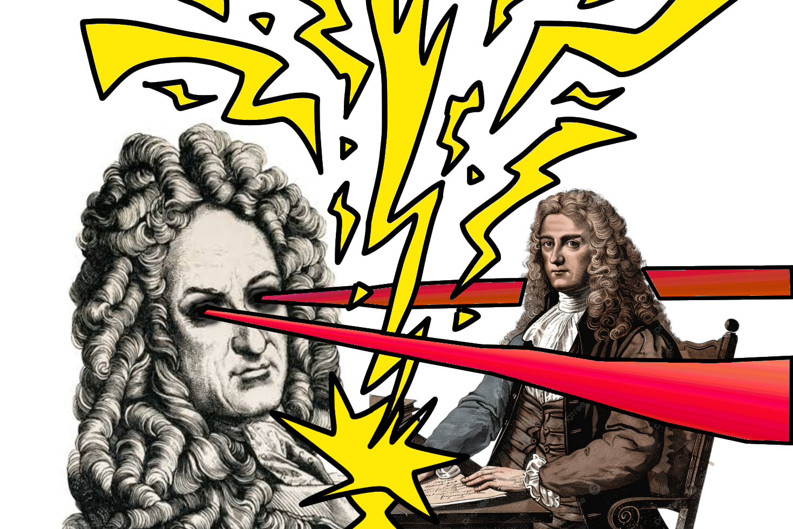

{fig-align="center" width="70%"}

### Hello Newton 
This semester I'm taking Michael Esfeld's course on the philosophy of physics at EPFL, and I wanted to talk about one idea I found interesting.

I will try to keep the philosophy to a minimum since it's not the main point I want to discuss.

Essentially when Newton established his laws of motion, he needed an absolute space and time to exist by themselves independently of the objects in the universe.

As a physical theory it works great, but some people (namely, Leibniz) had issues with the ontology it proposes. The ontology of a theory is basically all the things that exist independetly of everything else. A good ontology should not have more things than what is absolutelly neccesary to explain the phenomena we observe (this is called parsimony).

### Hello Leibniz
Leibniz argued that in Newton's view (substantivalism), configurations that were rotated or translated with respect to this absolute space could not be distinguished and behave just the same, even if they are two different configurations of the universe. The same goes for time and velocity, if every event in the universe happened 5 seconds later or with a constant velocity, we still have no way of telling the difference.

In Leibniz's view (relationalism), you only really need the distances between objects and the order of configurations. The thing is that nowhere in this ontology it says how long things take, only in what order they happen. This seems strange at first since it doesn't fit with our experience of the world and it doesn't even let us use the concept of velocities. 

 I don't want to get into the arguments for or against this, but from a physics standpoint it actually is possible to write Newtonian mechanics in a way that only uses these two things, and time and velocity come out of it as derived concepts. Let's get into it.

### Paths in configuration space

Take the universe as $N$ particles with masses $m_i$ at positions $x_i$. A configuration of the whole universe is a single point in a $3N$-dimensional space, which we call configuration space. A history of the universe is then a path through this space. We have a sequence of configurations and an order, nothing more.

## Analytical mechanics and Jacobi's principle

We know from analytical mechanics that physical trajectories make stationary a scalar quantity known as the action. In its standard form (Hamilton's principle) it is written as an integral over time, with $T$ the kinetic energy and $V$ the potential energy:

$$
S = \int_{t_1}^{t_2} (T - V)\, dt ,
$$

where we compare all paths that go between two configurations in the same time $t_2 - t_1$. There is an alternative formulation (Maupertuis' principle) that compares paths with equal energy $E$ instead of equal time.The stationary quantiy is now the abbreviated action:

$$
W = \int \sum_i p_i \cdot dx_i ,
$$

But we still haven't got rid of time, since $p_i = m_i v_i = m_i \frac{dx_i}{dt}$. But now look at the term in the integrand, we can substitute and get the kinetic energy T:

$$
\sum_i p_i \cdot dx_i = \sum_i m_i\, v_i \cdot (v_i\, dt) = 2T\, dt ,
$$

Multiplying again by $dt$ and noticing that $v_i\, dt = dx_i$ we get:

$$
2T\, dt^2 = \sum_i m_i\, (v_i\, dt)\cdot(v_i\, dt) = \sum_{i=1}^N m_i \, dx_i \cdot dx_i .
$$

The right hand side now doesn't depend on time at all, and with it we can define the length of an infinitesimal step along our path in configuration space:

$$
ds^2 = 2T dt^2 = \sum_{i=1}^N m_i \, dx_i \cdot dx_i .
$$
Intuitively we can think of $ds$ as a replacement of $dt$ that instead of time measures change in configuration space (its just a sum of displacements $dx_i$).

Putting everything together,

$$
\sum_i p_i \cdot dx_i = 2T\,\frac{ds}{\sqrt{2T}} = \sqrt{2T}\; ds = \sqrt{2(E - V)}\; ds .
$$

Everything that depends on time is now gone and we have Jacobi's principle. Every trajectory in the universe can be calculated using this and the principle of least action, whithout mentioning time. 

$$
S_J = \int_\gamma \sqrt{2\,(E - V)}\; ds
$$

### Why the label doesn't matter

To actually calculate anything along a path, we need to label the points with some parameter $\lambda$. Since we don't have time, $\lambda$ can be any increasing function.

The action of any given path is just a line integral, and if you've taken a vector calculus course you'll know that it's value won't depend on the parametrization: 

$$
\int_\gamma f\, ds = \int_a^b f\big(\gamma(\lambda)\big)\, \left|\frac{d\gamma}{d\lambda}\right| d\lambda ,
$$

Written out with a parameter $\lambda$, using $|d\gamma/d\lambda| = \sqrt{2T_\lambda}$, the action becomes

$$
S_J = \int 2\sqrt{(E - V)\, T_\lambda}\; d\lambda, \qquad T_\lambda = \frac12 \sum_i m_i \left(\frac{dx_i}{d\lambda}\right)^2 .
$$

$T_\lambda$ is what the kinetic energy would be if $\lambda$ were time. It is not physical, since it changes if we relabel the path, but the combination $\sqrt{T_\lambda}\,d\lambda$ doesn't.

### Where time comes from

Making $S_J$ stationary gives the equations of motion. With $x_i' = dx_i/d\lambda$, the Lagrangian is $L = 2\sqrt{(E-V)\,T_\lambda}$, and the Euler–Lagrange equations say

$$
\frac{d}{d\lambda}\left(\frac{\partial L}{\partial x_i'}\right) = \frac{\partial L}{\partial x_i} .
$$

Only $T_\lambda$ depends on the velocities, with $\partial T_\lambda/\partial x_i' = m_i x_i'$, and only $V$ depends on the positions.

$$
\frac{d}{d\lambda}\left( m_i \frac{dx_i}{d\lambda}\sqrt{\frac{E-V}{T_\lambda}} \right) = -\frac{\partial V}{\partial x_i}\sqrt{\frac{T_\lambda}{E-V}} .
$$

They look messy, but notice that the same factor $\sqrt{T_\lambda/(E-V)}$ appears on both sides (inverted on the left). This suggests choosing a new label $t$ that absorbs it:

$$
dt = \sqrt{\frac{T_\lambda}{E-V}}\; d\lambda = \frac{ds}{\sqrt{2(E - V)}} = \sqrt{\frac{\sum_i m_i \, dx_i^2}{2\,(E - V)}} .
$$

With this label the momentum becomes $p_i = m_i\, dx_i/dt$, and the equations of motion become

$$
m_i \frac{d^2 x_i}{dt^2} = -\frac{\partial V}{\partial x_i} ,
$$

which is Newton's second law. Any other label would leave extra terms in the equations, so $t$ is the unique label (up to choosing units and a starting point) in which the law takes its simplest form. We call it time.

### Not so surprinsing
It is not surprising that we arrive at newton's laws, since the analytical mechanics concepts we borrowed were built explicitely to produce them. The point is that instead of taking time as fundamental we can take the Jacobi action as fundamental and derive time from it. 

In my daily life I will likely still use Newton's laws, but it's a nice example of math alone can't tell us how the universe really is. These two formalisms produce equivalent predictions but have very different philosophical implications.

This will change a bit when we talk about absolute space, but I will leave that for another post.